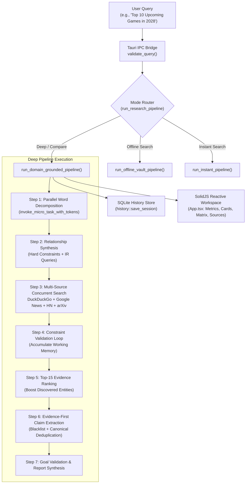
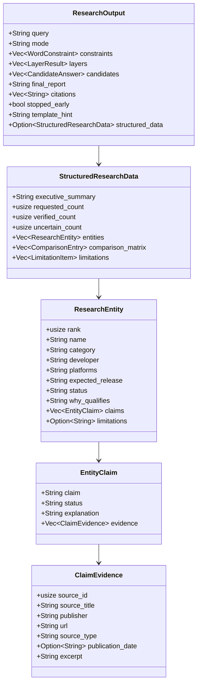
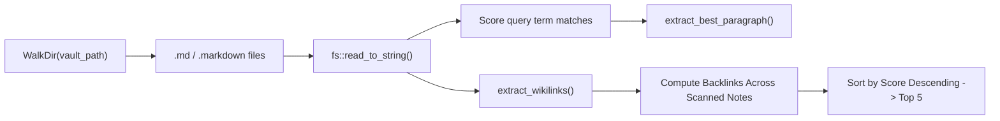
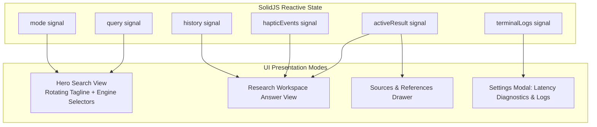

# 🏛️ Research Agent: Complete Function-by-Function Codebase & Architectural Guide

> **Version:** 2.2.3  
> **Mission:** *"Proof Over Hallucination."* — The Open-Source, Offline-First Perplexity Alternative.  
> **Core Architectural Paradigm:** Single Micro-Task Principle • Evidence-First Grounding • Zero Cloud Leaks • Strict Boundary Isolation  
> **Target Audience:** Core Contributors, Security Auditors, Open-Source Developers, and Systems Engineers looking to enhance security, expand capabilities, and improve research usefulness.

---

## 📑 Table of Contents

1. [Executive Architecture & System Topology](#1-executive-architecture--system-topology)
2. [Data Contracts & Core Structures](#2-data-contracts--core-structures)
3. [Module: Tauri IPC & Desktop Host (`src-tauri/src/lib.rs` & `main.rs`)](#3-module-tauri-ipc--desktop-host-src-taurisrclibrs--mainrs)
4. [Module: SSRF & Network Boundary Protection (`src-tauri/src/ssrf.rs`)](#4-module-ssrf--network-boundary-protection-src-taurisrcssrfrs)
5. [Module: Multi-Source Search & Web Retrieval (`src-tauri/src/search.rs`)](#5-module-multi-source-search--web-retrieval-src-taurisrcsearchrs)
6. [Module: Multi-Protocol Micro-Task LLM Client (`src-tauri/src/llm.rs`)](#6-module-multi-protocol-micro-task-llm-client-src-taurisrcllmrs)
7. [Module: Connectivity & Health Diagnostics (`src-tauri/src/tester.rs`)](#7-module-connectivity--health-diagnostics-src-taurisrctesterrs)
8. [Module: Offline Obsidian Vault & Knowledge Graph (`src-tauri/src/vault.rs`)](#8-module-offline-obsidian-vault--knowledge-graph-src-taurisrcvaultrs)
9. [Module: Embedded SQLite Persistence & Session Store (`src-tauri/src/history.rs`)](#9-module-embedded-sqlite-persistence--session-store-src-taurisrchistoryrs)
10. [Module: Telemetry, Logging & Event Stream (`src-tauri/src/logger.rs`)](#10-module-telemetry-logging--event-stream-src-taurisrcloggerrs)
11. [Module: Core Research Pipeline & Reasoning Engine (`src-tauri/src/pipeline.rs`)](#11-module-core-research-pipeline--reasoning-engine-src-taurisrcpipeliners)
12. [Module: Reactive SolidJS Frontend Workspace (`src/App.tsx`, `App.css`, `index.tsx`)](#12-module-reactive-solidjs-frontend-workspace-srcapptsx-appcss-indextsx)
13. [End-to-End Execution Lifecycles](#13-end-to-end-execution-lifecycles)
14. [Comprehensive Security Audit & Attack Surface Analysis](#14-comprehensive-security-audit--attack-surface-analysis)
15. [Strategic Improvement Roadmap: Security, Functionality & Usefulness](#15-strategic-improvement-roadmap-security-functionality--usefulness)

---

## 1. Executive Architecture & System Topology

Research Agent is designed to solve a foundational flaw of large language models: **hallucinatory overconfidence and context degradation**. When an LLM is asked to perform multiple cognitive steps simultaneously (interpreting vague queries, fetching web data, ranking evidence, cross-verifying claims, and composing a formatted answer), it often hallucinates facts, invents release dates, or substitutes real entities with news publishers or generic blog titles.

### The Single Micro-Task Principle
Instead of a monolithic prompt, Research Agent decomposes research workflows into isolated, single-responsibility micro-tasks:
1. **Parallel Word Interpretation:** Every word in the user's query is analyzed independently for semantic constraints.
2. **Intent Disambiguation & Constraint Synthesis:** Words are synthesized into a singular research goal with hard constraints and targeted IR queries.
3. **Multi-Source Concurrent Retrieval:** Live search engines, Google News RSS, Hacker News, arXiv preprints, or local Markdown vaults are queried in parallel.
4. **Evidence Ranking & Snippet Compression:** Unrelated domains are purged, discovered entities are boosted (+15.0 title / +8.0 snippet), and snippets are compressed to prevent context dilution.
5. **Entity & Claim-Level Verification:** Entities are extracted and validated against publisher blacklists and query echoes; each factual claim is bound to explicit source IDs and status tags (`Verified`, `Corroborated`, `Uncertain`, `Conflicting`).
6. **Goal Validation & Working Memory Fallback:** If the model extraction fails or yields zero candidates despite discovered items during research, the working memory grounds the items directly against cited sources.



### Technology Matrix
| Layer | Tech | Purpose | Security & Performance Rationale |
|---|---|---|---|
| **OS Host & IPC** | Rust 1.99+ / Tauri v2 | Native desktop application framework | Memory-safe backend, zero Node.js runtime in production, fine-grained OS capabilities |
| **Outbound Web Client** | `reqwest` 0.12 (rustls-tls) | HTTP/HTTPS web fetching | Avoids OpenSSL native link vulnerabilities; configured with strict connection timeouts (6s-60s) |
| **HTML / XML Parser** | `scraper` 0.22 / `regex` 1.11 | Scraping DuckDuckGo HTML, RSS, Atom XML | Robust against malformed XML/HTML; strips executable tags before feeding LLM |
| **Embedded DB** | `rusqlite` 0.32 (bundled) | Local session history & metadata | Zero network listener, stored in user's protected local data directory (`%LOCALAPPDATA%`) |
| **Offline Vault** | `walkdir` 2.5 + native fs | Markdown scanning & wikilinks parser | Zero outbound network calls; path traversal protection against OS root traversal |
| **Frontend UI** | SolidJS 1.9 + TypeScript 5.7 | Desktop user interface | Fine-grained reactivity (no virtual DOM diff overhead), minimal RAM footprint (~40MB idle) |
| **Styling & Theme** | Tailwind CSS v4 | Obsidian dark palette (`#121314`) | High contrast, accessible Geist typography scale, responsive print CSS |

---

## 2. Data Contracts & Core Structures

Data exchange between Rust backend modules, the SQLite store, and the SolidJS frontend is governed by strictly typed serializable structs defined across `pipeline.rs`, `search.rs`, `history.rs`, `llm.rs`, and `logger.rs`.



### Detailed Structural Definitions

#### `PipelineConfig` (`pipeline.rs:10`)
Controls the execution behavior of the pipeline for a single search invocation:
- `mode`: `"Deep Search"` | `"Instant Search"` | `"Compare Search"` | `"Offline Search"`
- `max_layers`: Depth of investigation (typically 3–5)
- `search_engine`: `"DuckDuckGo"` | `"SearXNG"` | `"Brave Search"`
- `searx_url`: Base URL for self-hosted SearXNG instance (e.g., `http://localhost:8080`)
- `brave_key`: Optional API subscription token for Brave Search
- `obsidian_vault_path`: Local filesystem path to markdown vault
- `llm`: Embedded `LlmConfig`

#### `LlmConfig` (`llm.rs:5`)
Defines connection parameters to LLM servers:
- `protocol`: `"openai"` | `"anthropic"` | `"ollama"` | `"custom"`
- `base_url`: Endpoint URL (e.g., `http://localhost:1234/v1`, `https://api.anthropic.com/v1`, `http://localhost:11434`)
- `model_name`: Model identifier (e.g., `llama-3.2-3b`, `claude-3-5-sonnet-latest`)
- `api_key`: Optional Bearer token or API key (masked in UI)

#### `ResearchOutput` (`pipeline.rs:153`)
The master payload returned to the frontend and persisted into SQLite:
- `query`: User's original validated query
- `mode`: Active research mode
- `constraints`: Vector of `WordConstraint` (word, why question, implied requirement)
- `layers`: Progression of research layers (`LayerResult`)
- `candidates`: Simplified top candidates (`CandidateAnswer`)
- `final_report`: Markdown-formatted document including sections, tables, and citations
- `citations`: Deduplicated URLs or local `file://` URIs
- `stopped_early`: Whether recursive evaluation halted on ground truth confirmation
- `template_hint`: `"ranked_list"` | `"comparison_table"` | `"news_feed"` | `"default_prose"`
- `structured_data`: `Option<StructuredResearchData>` for evidence card rendering

#### `SearchResult` (`search.rs:8`)
Atomic representation of an external information unit:
- `title`: Sanitized headline (stripped of HTML/XML entities)
- `snippet`: Compacted textual summary (max 120 words)
- `url`: Validated HTTP/HTTPS address or `file://` URI
- `source`: Optional publisher attribution (`"Google News"`, `"Hacker News"`, `"arXiv.org"`, `"DuckDuckGo"`, `"IGN"`, etc.)

---

## 3. Module: Tauri IPC & Desktop Host (`src-tauri/src/lib.rs` & `main.rs`)

### Responsibilities
`lib.rs` serves as the IPC gateway between the SolidJS webview and the native Rust core. It registers Tauri commands, enforces input sanitization, prevents path traversal, and coordinates exports.

### Function-by-Function Breakdown

#### `main()` (`main.rs:4`)
- **Signature:** `fn main()`
- **Logic:** Direct entry point. Employs `#![cfg_attr(not(debug_assertions), windows_subsystem = "windows")]` to suppress the auxiliary Windows terminal window in production builds. Calls `research_agent_lib::run()`.

#### `validate_query(raw_query: &str) -> Result<String, String>` (`lib.rs:15`)
- **Purpose:** Strict boundary validation for all queries originating from the frontend.
- **Constraints Enforced:**
  1. Minimum length: 2 characters (rejects empty or whitespace-only inputs).
  2. Maximum length: 500 characters (prevents memory bloat and prompt overflow attacks).
  3. Control character rejection: Any character with ASCII `< 32` (excluding `\t`, `\n`, `\r`) is rejected, eliminating null-byte injections (`\0`) and terminal escape exploits.
- **Return Value:** Sanitized trimmed `String` or descriptive error `Err(String)`.

#### `sanitize_export_filename(raw_filename: &str) -> Result<String, String>` (`lib.rs:30`)
- **Purpose:** Prevents path traversal and arbitrary file overwrite during report export.
- **Guards:**
  1. Empty checks and maximum 120-character limit.
  2. Path traversal rejection: Prohibits `..`, `/`, `\`, `:`, and `\0`.
  3. Whitelisted extensions: Strictly allows only `.md`, `.html`, or `.txt`.
  4. Character whitelist: Permits exclusively alphanumeric characters, dashes (`-`), underscores (`_`), periods (`.`), and spaces.
- **Return Value:** Sanitized filename or error.

#### `test_llm(protocol: String, base_url: String, api_key: Option<String>) -> TestResult` (`lib.rs:54`)
- **IPC Command:** `test_llm`
- **Logic:** Normalizes protocol name, validates against supported types (`"openai"`, `"anthropic"`, `"ollama"`, `"custom"`), and forwards to `tester::test_llm_endpoint`.
- **Return Value:** `TestResult` struct containing latency, connection status, and discovered model names.

#### `test_search(engine: String, url_or_key: String) -> TestResult` (`lib.rs:68`)
- **IPC Command:** `test_search`
- **Logic:** Validates search engine whitelist (`"searxng"`, `"google news"`, `"brave"`, `"brave search"`, `"duckduckgo"`, `"arxiv"`, `"hacker news"`) and executes connectivity verification via `tester::test_search_endpoint`.

#### `execute_research(app: tauri::AppHandle, query: String, mut config: PipelineConfig) -> Result<ResearchOutput, String>` (`lib.rs:83`)
- **IPC Command:** `execute_research`
- **Logic:**
  1. Runs `validate_query(&query)`.
  2. Fallbacks mode to `"Deep Search"` if invalid.
  3. Validates and normalizes `config.llm.protocol`.
  4. Invokes `pipeline::run_research_pipeline(Some(&app), &clean_query, &config)`.
- **Concurrency:** Asynchronous; spawns on Tokio runtime without blocking the webview thread.

#### `get_history() -> Result<Vec<SessionSummary>, String>` (`lib.rs:110`)
- **IPC Command:** `get_history`
- **Logic:** Queries SQLite for the 25 most recent sessions via `history::get_recent_sessions()`.

#### `get_history_detail(session_id: i64) -> Result<Option<FullSession>, String>` (`lib.rs:115`)
- **IPC Command:** `get_history_detail`
- **Logic:** Retrieves full report markdown, citations JSON, and metadata for a specific session ID.

#### `delete_history_item(session_id: i64) -> Result<(), String>` (`lib.rs:120`)
- **IPC Command:** `delete_history_item`
- **Logic:** Deletes a specific session row from SQLite database.

#### `clear_history() -> Result<(), String>` (`lib.rs:125`)
- **IPC Command:** `clear_history`
- **Logic:** Executes `DELETE FROM sessions` to purge history.

#### `count_vault_notes(vault_path: String) -> usize` (`lib.rs:130`)
- **IPC Command:** `count_vault_notes`
- **Logic:** Traverses directory with `walkdir::WalkDir`, counting files matching `.md` or `.markdown`. Returns 0 if directory does not exist.

#### `save_markdown_export(filename: String, content: String) -> Result<String, String>` (`lib.rs:149`)
- **IPC Command:** `save_markdown_export`
- **Security Logic:**
  1. Validates filename via `sanitize_export_filename(&filename)`.
  2. Caps content size at 15MB (prevents disk-filling attacks).
  3. Resolves destination directory using `USERPROFILE` / `HOME` -> `Downloads`. Defaults safely to current directory.
  4. Writes bytes via `std::fs::write`.
- **Return Value:** Absolute path of saved file.

#### `get_pipeline_logs() -> Vec<logger::LogEntry>` (`lib.rs:173`)
- **IPC Command:** `get_pipeline_logs`
- **Logic:** Reads in-memory ring buffer of execution logs.

#### `clear_pipeline_logs()` (`lib.rs:178`)
- **IPC Command:** `clear_pipeline_logs`
- **Logic:** Clears in-memory log buffer.

#### `save_logs_export() -> Result<String, String>` (`lib.rs:183`)
- **IPC Command:** `save_logs_export`
- **Logic:** Formats buffer entries into a structured text document and exports to `Downloads/research-agent-logs-<timestamp>.txt`.

#### `save_vault_export(vault_path: String, query: String, mode: String, content: String, citations: Vec<String>) -> Result<String, String>` (`lib.rs:200`)
- **IPC Command:** `save_vault_export`
- **Logic:** Calls `vault::export_to_obsidian_vault` to save research output directly into an Obsidian vault folder.

#### `run()` (`lib.rs:212`)
- **Logic:** Initializes the Tauri builder, registers `tauri_plugin_opener`, binds all 13 Tauri IPC handlers, and starts the event loop.

---

## 4. Module: SSRF & Network Boundary Protection (`src-tauri/src/ssrf.rs`)

### Responsibilities
Server-Side Request Forgery (SSRF) is a primary vulnerability in agentic research systems that fetch external URLs. Malicious or compromised sources could direct the agent to query `http://169.254.169.254` (cloud credentials), `http://localhost:8080`, or local router gateways. `ssrf.rs` provides strict network-level protection.

```mermaid
flowchart TD
    TargetURL["Target URL String"] --> Parse["Url::parse(target)"]
    Parse -->|Invalid Format| Reject["Err: Invalid URL"]
    Parse -->|Valid| SchemeCheck{"Scheme == http | https?"}
    SchemeCheck -->|No (e.g., file://, ftp://)| Reject
    SchemeCheck -->|Yes| HostExtract["Extract Hostname & Strip Brackets"]
    HostExtract --> BlocklistCheck{"Host in BLOCKED_HOSTS\nor ends with .blocked?"}
    BlocklistCheck -->|Yes| RejectBlocked["Err: Internal/private hostname blocked"]
    BlocklistCheck -->|No| IPCheck{"Is Host an IP Literal?"}
    IPCheck -->|Yes| IPRestricted{"is_private_or_restricted(ip)?"}
    IPRestricted -->|Yes| RejectIP["Err: Access to private/local IP blocked"]
    IPRestricted -->|No| Allow["Ok(Url)"]
    IPCheck -->|No (Domain Name)| Allow
```

### Constant Definitions
```rust
const BLOCKED_HOSTS: &[&str] = &[
    "localhost",
    "127.0.0.1",
    "::1",
    "0.0.0.0",
    "host.docker.internal",
    "metadata.google.internal",
    "169.254.169.254", // AWS/GCP/Azure instance metadata
];
```

### Function-by-Function Breakdown

#### `validate_external_url(target: &str) -> Result<Url, String>` (`ssrf.rs:16`)
- **Inputs:** `target` URL string.
- **Validation Pipeline:**
  1. Parses URL using `url::Url::parse`.
  2. Protocol validation: Strictly requires `http` or `https`. Denies `file://`, `gopher://`, `data:`, `ftp://`.
  3. Hostname normalization: Trims IPv6 bracket notations (`[` and `]`).
  4. Blocklist enforcement: Checks against `BLOCKED_HOSTS` and wildcard subdomains (e.g. `*.localhost`, `*.169.254.169.254`).
  5. IP literal inspection: If the hostname parses into a standard `std::net::IpAddr`, invokes `is_private_or_restricted(ip)`.
- **Return Value:** Validated `Url` struct or descriptive security error.

#### `is_private_or_restricted(ip: IpAddr) -> bool` (`ssrf.rs:48`)
- **Inputs:** Parsed `IpAddr` (IPv4 or IPv6).
- **Checks Enforced:**
  - **IPv4:**
    - `is_loopback()` (`127.0.0.0/8`)
    - `is_private()` (`10.0.0.0/8`, `172.16.0.0/12`, `192.168.0.0/16`)
    - `is_link_local()` (`169.254.0.0/16`)
    - `is_multicast()` (`224.0.0.0/4`)
    - `is_broadcast()` (`255.255.255.255`)
    - `is_documentation()` (`192.0.2.0/24`, `198.51.100.0/24`, `203.0.113.0/24`)
    - Zero-prefix checks (`0.0.0.0/8`)
  - **IPv6:**
    - `is_loopback()` (`::1`)
    - `is_multicast()` (`ff00::/8`)
    - Unique Local Addresses (ULA): `(segments[0] & 0xfe00) == 0xfc00` (`fc00::/7`)
    - Link-Local Unicast: `(segments[0] & 0xffc0) == 0xfe80` (`fe80::/10`)
- **Return Value:** `true` if restricted; `false` if publicly routable.

---

## 5. Module: Multi-Source Search & Web Retrieval (`src-tauri/src/search.rs`)

### Responsibilities
Manages information retrieval from external sources: DuckDuckGo, SearXNG, Brave Search, Google News RSS, Hacker News (Algolia API), and arXiv preprints. It features HTML sanitization, domain relevance filtering, and evidence ranking.

### Function-by-Function Breakdown

#### `execute_multi_source_search(...) -> Vec<SearchResult>` (`search.rs:16`)
- **Inputs:** `query`, `engine`, `searx_url`, `brave_key`, `domain_terms`, `excluded_terms`.
- **Execution Strategy:**
  1. Semantic Intent Detection:
     - Detects tech queries (`"software"`, `"ai"`, `"rust"`, `"python"`, etc.) -> triggers Hacker News retrieval.
     - Detects academic queries (`"paper"`, `"study"`, `"benchmark"`, `"quantum"`, `"biology"`, `"arxiv"`, etc.) -> triggers arXiv retrieval.
  2. Concurrency: Executes primary search engine, Google News RSS, Hacker News, and arXiv in parallel using `tokio::join!`.
  3. Deduplication: Inserts URLs into a `HashSet<String>` to eliminate duplicate results across sources.
  4. Filtering: Executes `filter_by_domain_relevance`.
  5. Telemetry: Logs retrieval counts per provider and latency via `logger::log_event`.
- **Return Value:** Filtered, deduplicated vector of `SearchResult`.

#### `execute_search(...) -> Result<Vec<SearchResult>, String>` (`search.rs:139`)
- **Logic:** Routes primary query based on configured engine (`"searxng"` -> `search_searxng`, `"brave"` -> `search_brave`, default -> `search_duckduckgo`).

#### `fetch_google_news_rss(query: &str) -> Result<Vec<SearchResult>, String>` (`search.rs:153`)
- **Purpose:** Fetches journalistic news articles without encountering anti-bot CAPTCHAs.
- **Logic:**
  1. URL-encodes the query.
  2. Fetches `https://news.google.com/rss/search?q={}&hl=en-US&gl=US&ceid=US:en` with a 6-second timeout.
  3. Parses returned XML using `parse_rss_xml`.

#### `strip_all_html(s: &str) -> String` (`search.rs:181`)
- **Purpose:** Completely strips raw HTML tags (`<tag>`) and escaped HTML tags (`&lt;tag&gt;`), then normalizes XML entities.
- **Logic:** Performs two passes of regex replacement (`<[^>]+>`) interleaved with `clean_xml_entities`.

#### `clean_xml_entities(s: &str) -> String` (`search.rs:248`)
- **Logic:** Replaces `&amp;`, `&quot;`, `&apos;`, `&lt;`, `&gt;`, `&#39;`, `&nbsp;`, and collapses multiple whitespace characters into single spaces.

#### `parse_rss_xml(xml: &str) -> Result<Vec<SearchResult>, String>` (`search.rs:192`)
- **Logic:** Employs pre-compiled regular expressions for `<item>`, `<title>`, `<link>`, `<description>`, and `<source>`. Splits titles on `" - "` to extract the publisher name (e.g. `"Game Title - IGN"` -> title: `"Game Title"`, publisher: `"IGN"`). Caps extraction at 8 items.

#### `fetch_hacker_news(query: &str) -> Result<Vec<SearchResult>, String>` (`search.rs:262`)
- **Logic:** Calls Algolia's public HN API: `https://hn.algolia.com/api/v1/search?query={}&tags=story&hitsPerPage=6`. Formats snippet with discussion points and comment counts (`Hacker News discussion (142 points, 88 comments)`).

#### `fetch_arxiv_search(query: &str) -> Result<Vec<SearchResult>, String>` (`search.rs:316`)
- **Logic:**
  1. Sanitizes academic query string.
  2. Passes target URL through `validate_external_url`.
  3. Queries `https://export.arxiv.org/api/query?search_query=all:{}&start=0&max_results=5` with a 6-second timeout and academic User-Agent.
  4. Parses Atom XML response with `parse_arxiv_xml`.

#### `parse_arxiv_xml(xml: &str) -> Result<Vec<SearchResult>, String>` (`search.rs:342`)
- **Logic:** Uses regex to extract `<entry>`, `<title>`, `<summary>`, `<id>`, `<author>`, and `<published>`. Formats snippets with lead author and publication year: `[Preprint: Vaswani et al., 2017] Attention Is All You Need...`.

#### `filter_by_domain_relevance(results, domain_terms, excluded_terms) -> Vec<SearchResult>` (`search.rs:401`)
- **Logic:**
  - Evaluates concatenated title and snippet in lowercase.
  - Rejection pass: If text contains any `excluded_terms` (e.g., `"textiles"` or `"typing test"` when querying games), drops item immediately.
  - Whitelist pass: If `domain_terms` are provided, requires matching at least one term.

#### `rank_and_select_top_evidence(...) -> Vec<SearchResult>` (`search.rs:449`)
- **Purpose:** Core heuristic ranker that scores, sorts, compacts, and selects top evidence.
- **Scoring Algorithm:**
  1. Stop-word filtering: Eliminates generic English stop-words (`"the"`, `"in"`, `"for"`, etc.).
  2. Near-duplicate deduplication: Deduplicates titles using the first 30 alphanumeric characters.
  3. Baseline Query Match: Title match = `+3.0`, Snippet match = `+1.5`.
  4. Domain Keyword Match: Title match = `+3.5`, Snippet match = `+1.5`.
  5. Discovered Candidate Boost: Target entities found in working memory receive `+15.0` for title matches and `+8.0` for snippet matches (prioritizes deep dives on discovered candidates over generic aggregator lists).
  6. Penalty: Generic aggregator terms (`"calendar"`, `"list of"`, `"anticipated games"`) receive `-4.0`. Short snippets (`< 20` chars) receive `-1.0`.
  7. Authority Boost: Established news/developer sources receive `+2.0`.
  8. Snippet Compaction: Truncates snippets to 120 words to prevent context overflow.

#### `search_duckduckgo(query: &str) -> Result<Vec<SearchResult>, String>` (`search.rs:577`)
- **Logic:** Performs POST request to `https://html.duckduckgo.com/html/` with form parameter `q`. Parses returned HTML using `scraper::Html` selectors `.result`, `.result__title a`, `.result__snippet`. Decodes DDG redirect URLs (`clean_ddg_url`).

#### `clean_ddg_url(raw_url: &str) -> String` & `urlencoding_decode(s: &str)` (`search.rs:637`)
- **Logic:** Extracts target URL from DuckDuckGo's redirection wrapper parameter `uddg=...` and decodes percent-encoded characters.

#### `search_searxng(query: &str, searx_url: &str) -> Result<Vec<SearchResult>, String>` (`search.rs:657`)
- **Logic:** Calls `GET {searx_url}/search?q={}&format=json`. Strips HTML from JSON title and content fields.

#### `search_brave(query: &str, api_key: &str) -> Result<Vec<SearchResult>, String>` (`search.rs:692`)
- **Logic:** Queries `https://api.search.brave.com/res/v1/web/search` with header `X-Subscription-Token: {api_key}`.

#### `fetch_clean_webpage(url_str: &str) -> Result<String, String>` (`search.rs:723`)
- **Purpose:** Full-page content fetcher with SSRF validation and text extraction.
- **Logic:** Validates URL through `validate_external_url`. Fetches page (12-second timeout). Parses `<body>` text via `scraper`, removes excessive whitespace, and caps output at 8,000 characters.

---

## 6. Module: Multi-Protocol Micro-Task LLM Client (`src-tauri/src/llm.rs`)

### Responsibilities
Provides a unified client for OpenAI-compatible endpoints (LM Studio, vLLM, OpenAI), Anthropic Claude, and Ollama. It enforces temperature `0.2` for factual fidelity, a 60-second fail-fast timeout, and supports modern reasoning/thinking models (DeepSeek-R1, QwQ).

```mermaid
flowchart TD
    Invoke["invoke_micro_task_with_tokens(system, user, tokens)"] --> Timeout["tokio::time::timeout(60s)"]
    Timeout --> ProtoSwitch{"config.protocol"}
    
    ProtoSwitch -->|"openai" / "custom"| OAI["invoke_openai_compatible()"]
    ProtoSwitch -->|"anthropic"| Anth["invoke_anthropic()"]
    ProtoSwitch -->|"ollama"| OLL["invoke_ollama()"]
    
    OAI --> ContentExtract["extract_openai_message_content()\n(1. content -> 2. reasoning_content -> 3. reasoning -> 4. text)"]
    OAI -->|Fails with 400 System Role Error| Fallback["System-in-User Prompt Fallback Payload"]
    Fallback --> ContentExtract
    
    Anth --> AnthResp["Parse choices / content[0].text"]
    OLL --> OllamaExtract["Parse message.content or message.thinking"]
    
    ContentExtract --> LogEvent["logger::log_event('LLM', elapsed_ms)"]
    AnthResp --> LogEvent
    OllamaExtract --> LogEvent
```

### Function-by-Function Breakdown

#### `normalize_openai_chat_url(base: &str) -> String` (`llm.rs:24`)
- **Logic:** Normalizes OpenAI endpoints to prevent missing or duplicated paths:
  - `"http://localhost:1234"` -> `"http://localhost:1234/v1/chat/completions"`
  - `"http://localhost:1234/v1"` -> `"http://localhost:1234/v1/chat/completions"`
  - `"http://localhost:1234/v1/chat/completions"` -> unchanged.

#### `normalize_ollama_chat_url(base: &str) -> String` (`llm.rs:36`)
- **Logic:** Normalizes Ollama endpoint to `{base}/api/chat`.

#### `invoke_micro_task(...) -> Result<String, String>` (`llm.rs:47`)
- **Logic:** Convenience wrapper delegating to `invoke_micro_task_with_tokens` with default 4,096 token limit.

#### `invoke_micro_task_with_tokens(app, system, user, max_tokens, config) -> Result<String, String>` (`llm.rs:56`)
- **Logic:**
  1. Instantiates `reqwest::Client` with a 60-second connection timeout.
  2. Wraps the protocol future in `tokio::time::timeout(Duration::from_secs(60), fut)`.
  3. On success: Emits a structured log (`LLM responded in Xms`) with character count and max token parameter.
  4. On timeout: Emits an error log and returns a clear message instructing the user to check local LLM responsiveness.

#### `extract_openai_message_content(json: &serde_json::Value) -> Option<String>` (`llm.rs:119`)
- **Purpose:** Extracts text across standard and reasoning models.
- **Hierarchy:**
  1. `choices[0].message.content` (standard OpenAI/LM Studio response).
  2. `choices[0].message.reasoning_content` (DeepSeek-R1 / thinking models).
  3. `choices[0].message.reasoning` (alternative thinking models).
  4. `choices[0].text` (legacy completion endpoints).

#### `invoke_openai_compatible(...) -> Result<String, String>` (`llm.rs:156`)
- **Logic:**
  - Sends JSON payload with `temperature: 0.2`, `max_tokens`, and system/user messages.
  - Attaches Bearer authentication if `api_key` is present.
  - **Auto-Fallback on System Role Rejection:** Some local models (or custom fine-tunes) reject the `"system"` role with HTTP 400. If an error mentioning `"system"` or HTTP 400 is returned, it automatically retries with a single `"user"` message formatted as:
    `[SYSTEM INSTRUCTIONS]\n{system_prompt}\n\n[TASK]\n{user_prompt}`.

#### `invoke_anthropic(...) -> Result<String, String>` (`llm.rs:236`)
- **Logic:** Sends Claude-compliant payload to `{base}/messages` with `x-api-key`, `anthropic-version: 2023-06-01`, and `system` parameter.

#### `invoke_ollama(...) -> Result<String, String>` (`llm.rs:284`)
- **Logic:** Posts to `/api/chat` with `stream: false` and `options: { temperature: 0.2, num_predict: max_tokens }`. Checks `message.content` and falls back to `message.thinking` for thinking models.

---

## 7. Module: Connectivity & Health Diagnostics (`src-tauri/src/tester.rs`)

### Responsibilities
Enables the frontend Settings modal to ping configured LLM endpoints and search engines, measure real-world roundtrip latency in milliseconds, and discover loaded models without executing full research tasks.

### Function-by-Function Breakdown

#### `test_llm_endpoint(protocol, base_url, api_key) -> TestResult` (`tester.rs:13`)
- **Protocol Implementations:**
  - **Ollama:** Queries `{base_url}/api/tags` (4.5s timeout). On HTTP 200, parses `models[].name` and returns live status with model count.
  - **Anthropic:** Pings `https://api.anthropic.com` or custom URL. Returns live status with detected Claude models.
  - **OpenAI / LM Studio:** Queries `{clean_url}/models` with optional Bearer auth. Extracts model identifiers from `data[].id`.
- **Return Value:** `TestResult { live, latency_ms, message, detected_models }`.

#### `test_search_endpoint(engine, url_or_key) -> TestResult` (`tester.rs:147`)
- **Engine Implementations:**
  - **SearXNG:** Queries `{base}/search?q=test&format=json` (5s timeout).
  - **Brave Search:** Queries `https://api.search.brave.com/res/v1/web/search?q=test&count=1` with `X-Subscription-Token`.
  - **DuckDuckGo:** Performs test fetch to `https://html.duckduckgo.com/html/?q=ping` with browser User-Agent.

---

## 8. Module: Offline Obsidian Vault & Knowledge Graph (`src-tauri/src/vault.rs`)

### Responsibilities
Provides 100% offline local research over Markdown vaults. Scans directories recursively, extracts paragraphs matching query terms, discovers `[[wikilinks]]` and backlinks, and enables exporting reports directly into the user's vault.



### Function-by-Function Breakdown

#### `extract_wikilinks(content: &str) -> Vec<String>` (`vault.rs:20`)
- **Purpose:** Extracts Obsidian `[[wikilink]]` targets from Markdown content.
- **Regex:** `r"\[\[([^\]\|#]+)(?:[\|#][^\]]*)?\]\]"`
- **Logic:** Matches targets while ignoring display aliases (e.g. `[[Target Note|Custom Text]]` -> `"Target Note"`) and anchor links (`[[Target#Header]]` -> `"Target"`). Deduplicates results.

#### `search_markdown_vault(vault_dir: &str, query: &str) -> Vec<VaultNoteMatch>` (`vault.rs:36`)
- **Execution Strategy:**
  1. Tokenizes query into terms with length `> 2`.
  2. Scans `vault_dir` with `walkdir::WalkDir::new(path).follow_links(false)` (avoids infinite symlink loops).
  3. Filters for `.md` and `.markdown` extensions.
  4. Scores notes based on frequency of query term matches.
  5. Computes matched excerpt via `extract_best_paragraph`.
  6. Computes bi-directional backlinks: If note B's wikilinks contain note A's stem, note B is cataloged as a backlink for note A.
  7. Sorts matching notes by score descending and returns top 5.

#### `extract_best_paragraph(content: &str, terms: &[String]) -> String` (`vault.rs:170`)
- **Logic:** Splits document on double newlines (`\n\n`). Counts matching search terms per paragraph. Selects paragraph with the highest density of terms, compacting to 350 characters.

#### `export_to_obsidian_vault(vault_dir, query, mode, markdown, citations) -> Result<String, String>` (`vault.rs:202`)
- **Security Check:** Resolves canonical path. Rejects exports to root directories (`/`, `C:\`, `C:\Windows`) to prevent OS corruption.
- **Logic:**
  1. Creates subdirectory `Research Agent/` in the vault.
  2. Sanitizes query into a 40-character kebab-case filename (`research-note.md`).
  3. Prepends Obsidian YAML frontmatter (`title`, `date`, `mode`, `tags: [research, deep-search]`, `sources_count`).
  4. Appends Markdown content and numbered citation links. Writes to disk.

---

## 9. Module: Embedded SQLite Persistence & Session Store (`src-tauri/src/history.rs`)

### Responsibilities
Maintains embedded search session history, reports, and citations using `rusqlite`. Stored locally in the user's application data directory with zero network ports or cloud dependencies.

### Database Schema
```sql
CREATE TABLE IF NOT EXISTS sessions (
    id INTEGER PRIMARY KEY AUTOINCREMENT,
    query TEXT NOT NULL,
    mode TEXT NOT NULL,
    report_markdown TEXT NOT NULL,
    citations_json TEXT NOT NULL,
    layer_count INTEGER NOT NULL,
    candidate_count INTEGER NOT NULL,
    created_at TEXT NOT NULL
);

CREATE TABLE IF NOT EXISTS app_meta (
    key TEXT PRIMARY KEY,
    value TEXT NOT NULL
);
```

### Function-by-Function Breakdown

#### `get_db_path() -> PathBuf` (`history.rs:23`)
- **Logic:** Locates local app data directory via `LOCALAPPDATA` (Windows) or `~/.local/share` (Linux/macOS), creates `research-agent/` folder, and returns path to `history.db`.

#### `init_tables(conn: &Connection) -> Result<()>` (`history.rs:31`)
- **Logic:**
  1. Executes DDL statements for `sessions` and `app_meta`.
  2. Welcome Seed Chat: Checks if `app_meta.seeded_welcome` exists. If not, seeds an introductory session explaining the single micro-task principle, shortcuts, and capabilities, setting `seeded_welcome = 1`.

#### `init_db() -> Result<Connection>` (`history.rs:112`)
- **Logic:** Opens connection to `history.db` and ensures tables are initialized.

#### `save_session(query, mode, report_markdown, citations, layer_count, candidate_count) -> Result<i64>` (`history.rs:119`)
- **Logic:** Serializes citations vector to JSON string and executes parameterized SQL `INSERT INTO sessions`. Returns `last_insert_rowid()`.

#### `delete_session(session_id: i64) -> Result<()>` (`history.rs:148`)
- **Logic:** Executes parameterized `DELETE FROM sessions WHERE id = ?1`.

#### `clear_all_sessions() -> Result<()>` (`history.rs:154`)
- **Logic:** Executes `DELETE FROM sessions`.

#### `get_recent_sessions() -> Result<Vec<SessionSummary>>` (`history.rs:160`)
- **Logic:** Executes `SELECT id, query, mode, layer_count, candidate_count, created_at FROM sessions ORDER BY id DESC LIMIT 25`.

#### `get_session_details(session_id: i64) -> Result<Option<FullSession>>` (`history.rs:185`)
- **Logic:** Fetches full markdown report and deserializes `citations_json` for a specific session ID.

---

## 10. Module: Telemetry, Logging & Event Stream (`src-tauri/src/logger.rs`)

### Responsibilities
Maintains a 1,000-entry in-memory ring buffer of execution logs with millisecond timestamps, emitting Tauri window events (`pipeline-log`) in real time for UI terminal diagnostics.

### Data Model: `LogEntry`
- `timestamp`: Formatted time (`HH:MM:SS.mmm`)
- `level`: `"INFO"` | `"SEARCH"` | `"RANK"` | `"LLM"` | `"WARN"` | `"ERROR"` | `"DONE"`
- `elapsed_ms`: Milliseconds elapsed since pipeline start
- `message`: Diagnostic log text

### Function-by-Function Breakdown

#### `log_event(app: Option<&tauri::AppHandle>, level: &str, elapsed_ms: u64, message: &str)` (`logger.rs:16`)
- **Logic:**
  1. Formats log entry with local timestamp.
  2. Prints to standard output.
  3. Locks `LOG_BUFFER` mutex; if buffer length reaches 1,000, removes oldest element (`buf.remove(0)`) and pushes new entry.
  4. If `app` handle is provided, emits event `pipeline-log` with the entry payload.

#### `get_all_logs() -> Vec<LogEntry>` (`logger.rs:41`)
- **Logic:** Acquires mutex lock and returns a clone of the log buffer.

#### `clear_logs()` (`logger.rs:45`)
- **Logic:** Acquires mutex lock and empties the buffer.

---

## 11. Module: Core Research Pipeline & Reasoning Engine (`src-tauri/src/pipeline.rs`)

### Responsibilities
The central orchestrator of Research Agent. It coordinates parallel word decomposition, query synthesis, constraint validation loops, working memory accumulation, entity filtering, claim verification, and template-based markdown report generation.

```mermaid
sequenceDiagram
    autonumber
    actor User
    participant Frontend as SolidJS Frontend
    participant Pipeline as pipeline.rs
    participant LLM as llm.rs
    participant Search as search.rs
    participant DB as history.rs

    User->>Frontend: Enter query & press Enter / Run
    Frontend->>Pipeline: invoke("execute_research", query, config)
    Pipeline->>Frontend: emit("research-progress", "disambiguation")
    
    rect rgb(24, 28, 32)
        Note over Pipeline,LLM: Step 1: Parallel Word Decomposition
        Pipeline->>LLM: invoke_micro_task for each query word (in parallel)
        LLM-->>Pipeline: WordInterpretation { word, meaning, implication }
    end

    rect rgb(28, 32, 38)
        Note over Pipeline,LLM: Step 2: Relationship Synthesis
        Pipeline->>LLM: invoke_micro_task(Synthesis Prompt)
        LLM-->>Pipeline: QuerySynthesis { goal, hard_constraints, ir_queries }
    end

    rect rgb(20, 30, 35)
        Note over Pipeline,Search: Step 3 & 4: Retrieval & Constraint Loop (Max 3 iterations)
        loop Up to 3 Iterations
            Pipeline->>Search: execute_multi_source_search(IR queries)
            Search-->>Pipeline: Web + News RSS + HN + arXiv results
            Pipeline->>LLM: Validate constraints against evidence
            LLM-->>Pipeline: ConstraintCheck { satisfied, missing, refined_query }
            Note over Pipeline: Accumulate missing items into Working Memory
        end
    end

    rect rgb(25, 25, 30)
        Note over Pipeline,LLM: Step 5 & 6: Ranking & Evidence Extraction
        Pipeline->>Search: rank_and_select_top_evidence(boost working memory)
        Search-->>Pipeline: Top 15 compacted evidence sources
        Pipeline->>LLM: invoke_micro_task(Extractor Prompt with candidate hint)
        LLM-->>Pipeline: Raw JSON (Entities, Claims, Statuses)
    end

    Note over Pipeline: Goal Validation & Output Synthesis
    Pipeline->>Pipeline: parse_and_structure_evidence()
    Pipeline->>DB: save_session()
    Pipeline-->>Frontend: ResearchOutput (Report, Structured Data, Citations)
    Frontend->>User: Render Interactive Evidence Cards & Matrix
```



### Function-by-Function Breakdown

#### `is_disallowed_entity_name(name: &str) -> bool` (`pipeline.rs:213`)
- **Purpose:** Strict blacklist guard preventing media publishers, blogs, and news aggregators from being cataloged as candidate entities.
- **Blacklisted Entities:** Includes `"searxng"`, `"gamesradar"`, `"ign"`, `"cbs sports"`, `"forbes"`, `"bloomberg"`, `"youtube"`, `"reddit"`, `"twitter"`, `"x.com"`, `"hacker news"`, `"techcrunch"`, `"the verge"`, `"polygon"`, `"kotaku"`, `"wired"`, `"reuters"`, `"associated press"`, `"release calendar"`, `"pc gamer"`, `"tom's hardware"`, `"eurogamer"`, `"gamespot"`, `"google news"`, `"bing news"`, `"duckduckgo"`, `"wikipedia"`.

#### `is_valid_candidate_entity(name: &str, query: &str) -> bool` (`pipeline.rs:243`)
- **Purpose:** Multi-stage validator for extracted entity names.
- **Filter Stages:**
  1. Length guard: Rejects `< 2` or `> 80` characters.
  2. HTML/XML guard: Rejects names containing `<`, `>`, `&lt;`, `&gt;`.
  3. URL/Domain guard: Rejects names with `http://`, `https://`, `www.`, `.com`, `.org`, `.net`, `.io`.
  4. Publisher blacklist: Checks `is_disallowed_entity_name`.
  5. Container phrase filter: Rejects generic container labels (`"upcoming games"`, `"most anticipated"`, `"release calendar"`, `"timeline of"`, `"list of"`, `"top 10"`, `"top 5"`, `"latest releases"`, `"research subject"`).
  6. Query Echo Filter: Computes word overlap between candidate name and user query. If `>= 80%` of candidate words are query tokens (e.g. Query: `"Upcoming Games 2028"` -> Candidate: `"Upcoming Games 2028"`), the candidate is rejected as a regurgitated query fragment.

#### `extract_requested_count(query: &str) -> Option<usize>` (`pipeline.rs:339`)
- **Logic:** Identifies requested quotas in queries (e.g. `"top 10"` -> 10, `"5 best"` -> 5, `"top 3"` -> 3) using token inspection. Caps valid quota at 50.

#### `emit_haptic(app, step, message, detail)` (`pipeline.rs:369`)
- **Logic:** Emits Tauri event `research-haptic` with `HapticEvent { step, message, detail }` to update the real-time activity timeline in the UI.

#### `canonical_entity_key(name: &str) -> String` (`pipeline.rs:435`)
- **Purpose:** Normalizes entity titles for deduplication.
- **Transformations:**
  1. Lowercases and strips leading `"the "`.
  2. Strips punctuation (`:`, `-`, `,`, `.`, `'`, `"`, `(`, `)`).
  3. Roman Numeral Normalization: Converts Roman numerals at token level to Arabic digits (`"ii"` -> `"2"`, `"iv"` -> `"4"`, `"v"` -> `"5"`). Ensures `"The Witcher IV"` and `"The Witcher 4"` map to identical canonical keys (`"witcher 4"`).

#### `parse_and_structure_evidence(...) -> (StructuredResearchData, Vec<CandidateAnswer>, String)` (`pipeline.rs:466`)
- **Inputs:** Raw LLM JSON string, query, target entity type, requested quota, top evidence sources, template hint, total source count, and discovered candidate list.
- **Processing Logic:**
  1. Cleans JSON with `clean_json_str`.
  2. Deserializes into `RawEvidenceExtraction`.
  3. Validates every entity via `is_valid_candidate_entity` and deduplicates using `canonical_entity_key`.
  4. Resolves Claim Evidence: Maps numeric `source_ids` (`[1]`, `[2]`) to actual URLs and publishers in `top_evidence`. Assigns status tags (`Verified`, `Corroborated`, `Uncertain`, `Conflicting`).
  5. **Goal & Output Validation Check:** If the LLM extraction produced 0 valid entities despite candidate subjects having been discovered during research iterations, this fallback synthesizes grounded candidate entries using the accumulated working memory and matching source snippets.
  6. Generates Comparison Matrix: Builds comparison entries with confidence ratings (`High`, `Medium`, `Low`).
  7. Formats Limitations: Injects limitation entries and automatically adds a `"Target Quota Discrepancy"` if fewer verified items were confirmed than requested.
  8. Builds Markdown Report: Constructs a 6-section document:
     - Section 1: Executive Summary & Overview Metrics
     - Section 2: Results (Ranked Entity Cards or Clean Source Excerpts)
     - Section 3: Evidence & Claim Verification
     - Section 4: Comparison Matrix
     - Section 5: Analysis & Strategic Insights
     - Section 6: Research Limitations & Information Gaps

#### `run_research_pipeline(app, query, config) -> Result<ResearchOutput, String>` (`pipeline.rs:845`)
- **Logic:** Master dispatcher. Routes to `run_offline_vault_pipeline` for offline mode, `run_instant_pipeline` for instant mode, or `run_domain_grounded_pipeline` for deep search.

#### `run_domain_grounded_pipeline(app, query, config) -> Result<ResearchOutput, String>` (`pipeline.rs:865`)
- **Execution Workflow:**
  1. **Step 1: Parallel Word-Level Interpretation:** Splits query into individual words. Dispatches concurrent `invoke_micro_task_with_tokens` requests to analyze the semantic role and research implication of each word.
  2. **Step 2: Relationship Synthesis:** Sends word interpretations to LLM to produce a consolidated research goal, hard constraints, search keywords, and IR queries.
  3. **Step 3 & 4: Search & Validation Loop (Max 3 iterations):**
     - Queries search providers with current IR queries.
     - Validates hard constraints against retrieved titles and snippets using constraint checker micro-prompt.
     - Working Memory Accumulation: Captures candidate entities identified in `check.missing` into `accumulated_discovered_entities`.
     - Refines queries if constraints are unsatisfied. Early-stops when satisfied.
  4. **Step 5: Top-15 Evidence Ranking:** Ranks retrieved results using `rank_and_select_top_evidence`, applying the `+15.0` boost for discovered candidate entities. Compresses snippets.
  5. **Step 6: Evidence-First Claim Extraction:** Passes compressed evidence and discovered candidates hint to extractor micro-prompt (2,500 token ceiling).
  6. **Step 7: Structuring & Persistence:** Calls `parse_and_structure_evidence`, saves session into SQLite, and returns `ResearchOutput`.

#### `run_instant_pipeline(app, query, config) -> Result<ResearchOutput, String>` (`pipeline.rs:1542`)
- **Logic:** Fast 1-pass verification engine (~2–3 seconds). Queries search providers once, selects top 5 ranked articles, prompts LLM for a concise 2–3 paragraph cited report with inline citation numbers, saves to SQLite, and returns output.

#### `run_offline_vault_pipeline(app, query, config) -> Result<ResearchOutput, String>` (`pipeline.rs:1706`)
- **Logic:** 100% offline pipeline. Queries local vault via `search_markdown_vault`, constructs prompt containing local excerpts, synthesizes report with `[[Note]]` citations, appends connected knowledge graph notes, and persists session.

#### `strip_think_tags(s: &str) -> String` (`pipeline.rs:1829`)
- **Logic:** Removes `<think>...</think>` tags generated by reasoning models (DeepSeek-R1, QwQ) using regex `r"(?s)<think>.*?</think>"`.

#### `clean_json_str(s: &str) -> String` & `clean_json_delimiters(s: &str)` (`pipeline.rs:1834`)
- **Logic:** Strips think tags, extracts content from markdown code fences (````json ... ````), and slices outer brackets or braces (`[`...`]` or `{`...`}`) to handle conversational prefixes or trailing explanations.

---

## 12. Module: Reactive SolidJS Frontend Workspace (`src/App.tsx`, `App.css`, `index.tsx`)

### Responsibilities
Constructs the user interface using SolidJS fine-grained reactivity. Provides a Linear/Raycast/Perplexity style workspace featuring hero search, live haptic event streaming, research metrics badges, interactive claim-level evidence accordions, markdown exports, and diagnostic terminal log viewers.



### Key Frontend Functions & Handlers in `src/App.tsx`

#### `handleRunSearch(targetQuery?: string)` (`App.tsx:432`)
- **Logic:**
  1. Validates query; sets `isSearching = true`.
  2. Switches view to `"answer"`, resets activity timers, clears previous subqueries and haptics.
  3. Sets a placeholder `activeResult` so the UI immediately transitions to the answer layout with loading animations.
  4. Dispatches `invoke<ResearchOutput>("execute_research", { query, config })`.
  5. On completion: Updates `activeResult`, reloads history, stops timer, and handles errors gracefully.

#### `handleSelectSession(item: SessionSummary)` (`App.tsx:498`)
- **Logic:** Invokes `get_history_detail` for the clicked history ID, populates `activeResult`, and switches view to display the stored report and citations.

#### `handleDeleteSession(id: number, e: MouseEvent)` (`App.tsx:522`)
- **Logic:** Stops event propagation, calls `delete_history_item`, removes item from history signal, and resets view if active session was deleted.

#### `handleTestLlm()` & `handleTestSearch()` (`App.tsx:339` & `App.tsx:360`)
- **Logic:** Sets testing spinner, invokes Tauri commands `test_llm` and `test_search`, and displays live status badge with latency in milliseconds.

#### `exportMarkdown()` (`App.tsx:536`)
- **Logic:** Formats markdown with citations list and sanitized filename. First attempts native desktop save via `invoke("save_markdown_export")` to the user's `Downloads` folder. If IPC fails, falls back to DOM Blob anchor download.

#### `exportHtml()` (`App.tsx:589`)
- **Logic:** Compiles a standalone HTML document incorporating the rendered markdown, Obsidian dark theme CSS, responsive tables, and citations. Exports natively to `Downloads`.

#### `exportVault()` (`App.tsx:840`)
- **Logic:** Invokes `save_vault_export` to write the research report into the configured local Obsidian vault folder under `Research Agent/`.

#### `copyReport()` (`App.tsx:866`)
- **Logic:** Copies clean markdown report to system clipboard using `navigator.clipboard.writeText` and displays temporary `"✓ Copied"` checkmark.

#### `parseTemplateHint(md: string)` (`App.tsx:878`)
- **Logic:** Checks for leading `<!-- TEMPLATE: <hint> -->` annotation. Routes to specialized layout renderer: `"ranked_list"`, `"news_feed"`, `"comparison_table"`, `"flashcards"`, or `"default_prose"`.

#### `groupedHistory()` (`App.tsx:1024`)
- **Logic:** Groups history records chronologically into `"Today"`, `"Yesterday"`, and `"Older"`.

#### `loadLogs()`, `clearLogs()`, `copyLogs()`, `exportLogsToFile()` (`App.tsx:381-425`)
- **Logic:** Manages execution telemetry in the Terminal Logs tab. Provides clipboard copying, log clearing, file export, and direct link to file GitHub issues with pre-filled logs.

---

## 13. End-to-End Execution Lifecycles

### Deep Search Lifecycle (Step-by-Step)
1. **User Submission:** User types query `"Top 10 upcoming games in 2028"` and presses `Enter`.
2. **IPC Ingestion:** `execute_research` in `lib.rs` validates query length and ASCII characters.
3. **Word Decomposition:** `pipeline.rs` decomposes `"Top"`, `"10"`, `"upcoming"`, `"games"`, `"in"`, `"2028"` into parallel micro-prompts.
4. **Intent Synthesis:** Synthesizes goal: `"Identify video games with confirmed or projected roadmaps targeting 2028"`, hard constraints: `["scheduled for 2028", "at least 10 games"]`, IR queries: `["upcoming games 2028 release date", "video games roadmap 2028"]`.
5. **Concurrent Retrieval:** Queries primary engine + Google News RSS + HN + arXiv in parallel.
6. **Constraint Validation Loop:** Constraint validator checks evidence. Detects missing items, refines search queries, and stores candidate titles (e.g. `"The Witcher 4"`, `"Gothic 5"`) in `accumulated_discovered_entities`.
7. **Ranking & Compaction:** Ranks top 15 evidence items with a `+15.0` boost for discovered entities. Compresses snippets.
8. **Extraction & Grounding:** LLM extracts entities and claims. If LLM extraction is empty, Goal Validation activates and grounds discovered entities directly using evidence snippets.
9. **Persistence & Presentation:** Persists session in SQLite `history.db`. Frontend renders interactive cards, claim status tags, and comparison matrix.

### Offline Vault Lifecycle
1. User selects `"Offline Search"` and enters `"Rust Concurrency"`.
2. `pipeline.rs` dispatches to `run_offline_vault_pipeline`.
3. `vault.rs` walks the directory, extracts matching paragraphs, and builds wikilink/backlink graphs. Zero network requests occur.
4. Local LLM synthesizes report citing `[[Note Titles]]`.
5. Report renders in UI with clickable local file links and connected graph notes.

---

## 14. Comprehensive Security Audit & Attack Surface Analysis

| Surface / Vector | Threat Description | Current Mitigation in Codebase | Recommended Hardening |
|---|---|---|---|
| **SSRF (Network)** | Malicious URLs targeting internal cloud metadata (`169.254.169.254`) or intranet IPs (`10.0.0.0/8`, `192.168.1.1`). | `ssrf::validate_external_url()` validates scheme, checks `BLOCKED_HOSTS`, and inspects IPv4/IPv6 address literals. | Resolve DNS before connect to prevent **DNS Rebinding / TOCTOU** attacks where a domain resolves to a public IP on validation but a private IP on fetch. |
| **Path Traversal (FS)** | Filename inputs with `../` attempting to overwrite system files (`/etc/passwd`, `C:\Windows\System32`). | `lib::sanitize_export_filename()` strictly rejects `..`, `/`, `\`, `:`, enforces alphanumeric whitelist, and restricts to `.md`, `.html`, `.txt`. | Enforce canonical path sandboxing using `dunce::canonicalize()` or explicit root containment checks. |
| **System Root Vault Export** | Attempting to export vault notes into system folders (`C:\Windows`, `/root`). | `vault::export_to_obsidian_vault()` canonicalizes vault path and explicitly rejects root directories (`/`, `C:\`, `C:\Windows`). | Maintain whitelist of permitted user data directories (`Documents`, `Notes`, `Desktop`). |
| **Command Injection (IPC)** | Executable code passed via Tauri IPC. | Tauri v2 does not invoke shell interpreters (`sh`, `cmd.exe`). All commands are compiled Rust functions. | Maintain strict typed serde inputs and length constraints on all future IPC handlers. |
| **Query Control Chars** | Null-byte injection (`\0`) or terminal escape injection. | `lib::validate_query()` rejects any char with ASCII `< 32` (except `\t`, `\n`, `\r`). | Retain this check across all search and export input channels. |
| **SQL Injection** | SQL injection in SQLite history store. | `history.rs` uses parameterized SQL queries exclusively (`params![query, mode, ...]` and `?1`). | Never introduce dynamic SQL string concatenation. |
| **Secrets in Plaintext** | API keys (Brave, OpenAI, Anthropic) stored in browser `localStorage`. | Keys are masked in the UI with password inputs and stored locally. | Migrate long-term API key storage to native OS credential vaults (Windows Credential Manager / macOS Keychain / Secret Service via `keyring-rs`). |
| **Content Security Policy (CSP)** | Injection of malicious scripts via parsed Markdown or search snippets. | Tauri CSP configured in `tauri.conf.json`; `marked` runs with GFM without allowing script execution; HTML exports use escaped queries. | Enforce strict DOMPurify pass over parsed markdown output in `App.tsx`. |

---

## 15. Strategic Improvement Roadmap: Security, Functionality & Usefulness

Contributors looking to enhance Research Agent can use this prioritized roadmap:

### 1. Security & Resilience Enhancements
- [ ] **DNS Pinning & Safe Client Wrapper:** Integrate custom `reqwest` socket address resolver that resolves DNS records and verifies that the resolved target IP is not private *at connection time*, completely eliminating DNS Rebinding / Time-Of-Check to Time-Of-Use (TOCTOU) risks.
- [ ] **Native Credential Vault Integration (`keyring-rs`):** Replace frontend `localStorage` API key storage with encrypted OS credential storage via native Rust `keyring` crate.
- [ ] **Frontend DOM Sanitization:** Integrate `DOMPurify` before rendering `marked.parse()` output in SolidJS to provide defense-in-depth against malicious HTML in search snippets.

### 2. Functionality & Retrieval Capabilities
- [ ] **Token Streaming (Server-Sent Events / Tauri Event Streaming):** Currently, micro-tasks await completion before returning. Implement token streaming over Tauri events (`pipeline-token`) so users see real-time synthesis tokens appear instantly.
- [ ] **Hybrid Dense-Sparse Local Retrieval (BM25 + Embeddings):** Upgrade `vault.rs` from keyword match scoring to hybrid search using SQLite FTS5 (BM25) combined with local lightweight embedding vectors (`ort` / ONNX runtime running `all-MiniLM-L6-v2`).
- [ ] **Full Webpage Deep Reader:** When snippets lack detail, automatically trigger `fetch_clean_webpage()` on the top 2 primary sources to extract detailed tables and disclosures.
- [ ] **Interactive Vault Knowledge Graph:** Expand the Connected Vault Graph in SolidJS into an interactive 2D canvas/SVG node graph showing note connections and backlinks visually.

### 3. Usefulness & Workflow Ergonomics
- [ ] **Multi-Turn Conversational Threads:** Allow users to ask follow-up questions that preserve the verified entities and evidence citations of the active session without re-running initial searches.
- [ ] **Export Integrations:** Add direct export buttons for **Notion**, **Google Docs**, and **Anki Flashcards** (for study/flashcard templates).
- [ ] **Global System Hotkey Overlay:** Add a configurable global hotkey (`Alt+Space` or `Ctrl+Shift+Space`) that summons a floating Raycast-style instant search bar from anywhere in the OS.
- [ ] **Custom System Directives:** Allow users to specify persistent custom research criteria in Settings (e.g. *"Always prioritize peer-reviewed papers"*, *"Prefer open-source MIT/Apache tools"*).

---

*This document serves as the canonical technical guide for Research Agent v2.2.3. All pull requests modifying IPC commands, search rankers, or security boundaries should be verified against the architectural invariants established here.*
