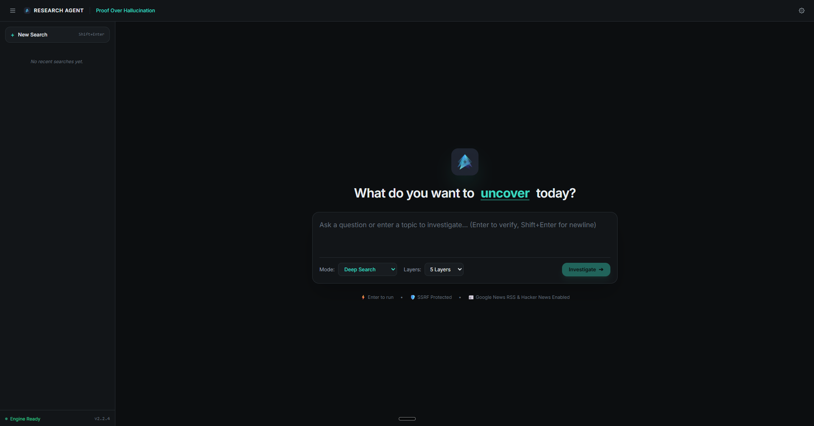
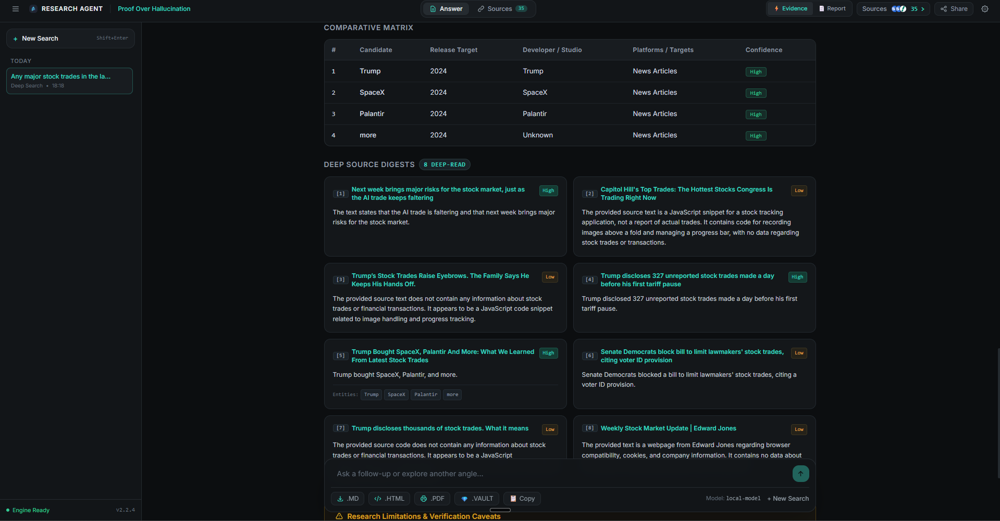
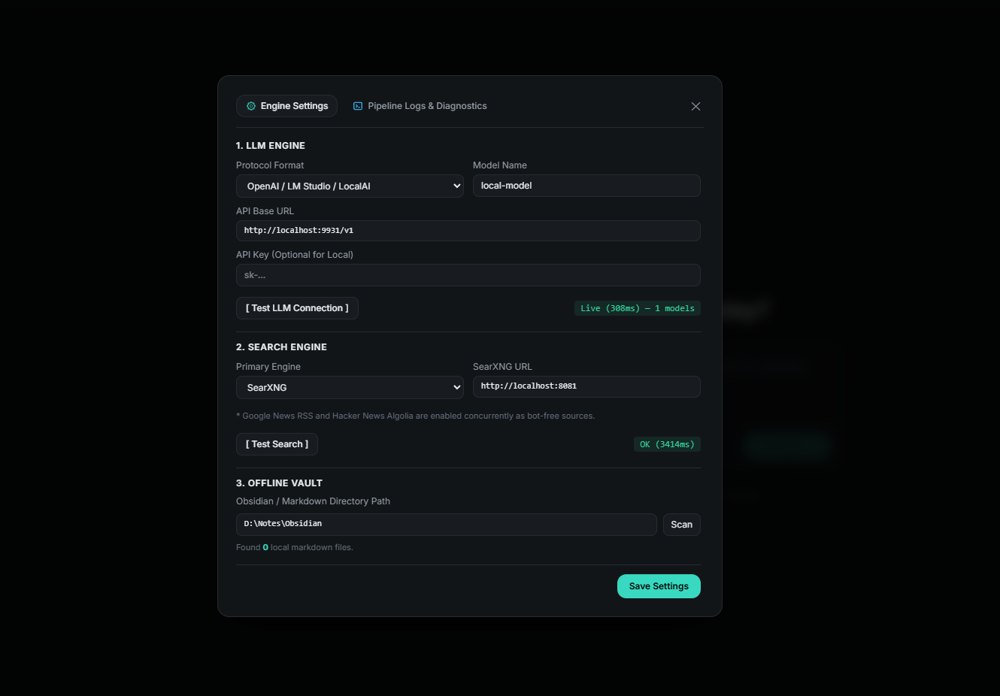
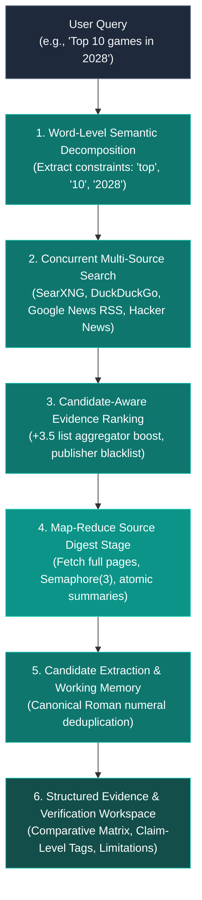
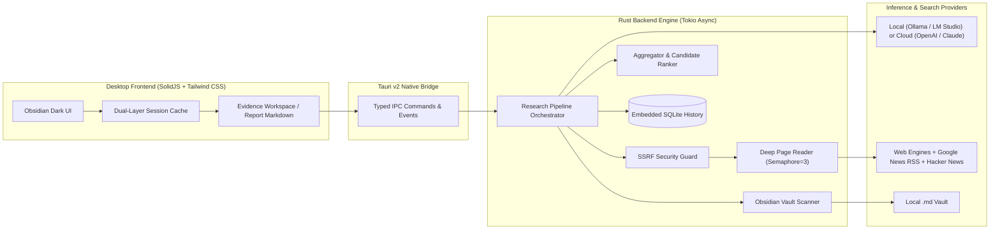

# 🔬 Research Agent (v2.2.4)

> **"Proof Over Hallucination."**  
> The Open-Source, Offline-First Perplexity Alternative.

[](https://github.com/PavanKumarVattikuti/research-agent/releases)
[](https://www.rust-lang.org/)
[](https://v2.tauri.app/)
[](https://www.solidjs.com/)
[](./LICENSE)
[]()
[]()

Research Agent is a lightweight, high-performance native desktop application designed to solve the critical flaw of modern LLMs: **hallucinations and overconfident guesswork**. Built with **Rust**, **Tauri v2**, and **SolidJS**, it operates on an **Evidence-First Architecture**—reading full web pages, decomposing queries into atomic micro-tasks, tracking claims against primary proofs, and presenting structured comparative answers with clickable citations.

---



---

## 📌 What is Research Agent? (In Simple Terms)

Most AI search engines browse snippets, guess details, or invent plausible-sounding facts when evidence is missing.

**Research Agent is different:**
- **It actually reads full web pages**, not just one-line search snippets.
- **It verifies before answering**: Every claim is tagged as `Verified`, `Corroborated`, `Uncertain`, or `Conflicting` with exact source excerpts.
- **It never hallucinates filler**: If public roadmaps or data do not exist, it honestly reports the gap instead of making up fake entries.
- **It is 100% private and offline-first**: Query local Obsidian markdown vaults or run entirely against local models (Ollama, LM Studio, LocalAI) without sending a single byte to external clouds.
- **It runs as an ultra-compact native app**: Compiled in Rust, the standalone desktop binary is only **~10.5 MB** and uses just **~35 MB RAM** (compared to bloated 200MB+ Python bundles).

---

## 📸 Screenshots & Interface Tour

### 1. Main Investigation Hub (`assets/run2.png`)
Clean Obsidian-inspired dark theme (`#121314`), rapid query input, 4 investigation modes, recursive 5-layer depth, and instant status indicators:


### 2. Evidence Workspace, Comparative Matrix & Source Digests (`assets/run3.png`)
Multi-candidate comparative table, 8-source Deep-Read digests with `High` / `Low` relevance badges, candidate entity extraction, and 1-click exports:


### 3. Engine Settings & Diagnostic Modal (`assets/run1.png`)
Multi-protocol LLM configuration (OpenAI, Anthropic, Ollama, LM Studio), real-time latency ping badge, SearXNG / RSS setup, and local Obsidian vault scanner:


---

## ⚙️ How It Works: The 6-Stage Research Workflow

Research Agent follows the **Single Micro-Task Principle**: *Never give an LLM multiple responsibilities in a single prompt.* Complex research goals are broken down into sequential, verifiable micro-tasks:



### Detailed Pipeline Breakdown:

1. **Word-Level Query Decomposition**:
   - Deconstructs input queries into individual semantic words and interprets their exact constraints (e.g., `top` $\rightarrow$ ranked, `10` $\rightarrow$ target quota, `2028` $\rightarrow$ release calendar).
   - Formulates a grounded research goal with explicit validation rules.
2. **Bot-Free Multi-Source Search**:
   - Queries standard web engines concurrently with **Google News RSS** and **Hacker News Algolia** to bypass anti-bot blocks and CAPTCHAs.
3. **Candidate-Aware Evidence Ranking**:
   - Identifies list/aggregator queries automatically, replacing generic aggregator penalties with a **`+3.5` score boost** for release calendars and trackers.
   - Automatically filters out news publisher homepages (GamesRadar, IGN, Forbes) from being extracted as subjects.
4. **Map-Reduce Source Digest Stage (Deep Page Reader)**:
   - Concurrently fetches clean full-text content (up to 6,000 characters) from top sources using `fetch_clean_webpage` with 6s timeouts and snippet fallbacks.
   - Bounded by a `tokio::sync::Semaphore::new(3)` to prevent saturating local GPUs (12GB VRAM).
   - Generates an atomic micro-digest per source (<=80-word summary, disclosed entities, relevance badge).
   - Synthesizes a unified cross-source summary citing sources as `[id]`.
5. **Candidate Extraction & Working Memory**:
   - Discovered candidate entities are injected into `accumulated_discovered_entities` (Working Memory) so intermediate findings are never forgotten.
   - Merges duplicates canonically across Roman numerals and naming variations (e.g., *The Witcher 4* and *The Witcher IV*).
6. **Verification & Structured Presentation**:
   - Compiles claims into verifiable cards, side-by-side comparative matrices, source-by-source provenance digests, and honest research limitations.

---

## 🏛️ System Architecture

Research Agent bridges a lightweight SolidJS webview with a native Rust backend via Tauri v2 IPC:



---

## 🛡️ Evidence Verification: Proof Over Hallucination

Research Agent establishes trust by making claim-level evidence transparent and testable:

| Claim Tag | Meaning | Criteria |
|---|---|---|
| **`Verified`** 🟢 | Primary Proof | Official developer announcements, primary corporate filings, peer-reviewed preprints, or confirmed benchmark tables. |
| **`Corroborated`** 🔵 | Multi-Source | Reported consistently across two or more independent reputable outlets. |
| **`Uncertain`** 🟡 | Speculation | Industry rumors, speculative timelines, insider leaks, or unconfirmed publisher projections. |
| **`Conflicting`** 🔴 | Disputed | Outlets report contradictory dates, conflicting specs, or disputed benchmark statistics. |

- **Exact Quoted Excerpts**: Every claim links to the verbatim excerpt from the source text.
- **Publisher Blacklist**: Prevents publisher domains (`searxng`, `ign.com`, `techcrunch`) from being misclassified as candidate entities.
- **Zero-Hallucination Fallback**: If the model extracts 0 candidate subjects from evidence, it **never invents fake cards**. The UI displays the verified source excerpts and clearly explains what was and wasn't found.

---

## 📑 Example Research Report Output

Here is an authentic sample of the structured output generated by Research Agent for the query *"Upcoming major AI hardware accelerators competing with NVIDIA B200 in 2025"*:

````markdown
# 🔬 Research Report: 2025 Frontier AI Hardware Accelerators

### 📊 Research Metrics
| Metric | Value |
|---|---|
| **Target Quota Requested** | 5 |
| **Verified Candidates Discovered** | 4 |
| **Deep-Read Sources** | 8 |
| **Total Sources Checked** | 32 |

---

### 1. Executive Summary
Four major enterprise AI accelerator architectures are confirmed for 2025 deployment targeting NVIDIA Blackwell B200 competition: AMD Instinct MI350X, Google TPU v6 (Trillium), Intel Gaudi 3, and Tenstorrent Wormhole/Blackhole. While AMD and Google provide concrete tape-out timelines and memory bandwidth targets, custom ASIC availability remains heavily constrained by CoWoS packaging allocation.

---

### 2. Discovered Candidates

#### 1. AMD Instinct MI350X
- **Developer / Manufacturer**: AMD
- **Architecture**: CDNA 4 (3nm node)
- **Memory**: Up to 288GB HBM3e
- **Target Launch**: Mid-2025 [1]
- **Verification**: `Verified` 🟢 (Primary Computex keynote roadmap disclosure)

#### 2. Google TPU v6 (Trillium)
- **Developer**: Google / Alphabet
- **Efficiency Target**: 4.7x compute efficiency increase per chip over v5e [4]
- **Target Deployment**: Early 2025 [4]
- **Verification**: `Corroborated` 🔵 (Confirmed via Google Cloud announcements & Reuters)

---

### 3. Comparative Matrix
| # | Candidate | Expected Release | Process Node | Primary Metric | Confidence |
|---|---|---|---|---|---|
| 1 | AMD Instinct MI350X | Mid-2025 | 3nm | 288GB HBM3e | High |
| 2 | Google TPU v6 | Q1-Q2 2025 | Custom ASIC | 4.7x Performance/Watt | High |
| 3 | Intel Gaudi 3 | 2024-2025 | 5nm | 128GB HBM2e | Medium |
| 4 | Tenstorrent Blackhole | 2025 | 6nm | RISC-V Native FP8 | Medium |

---

### 4. Deep Source-by-Source Summaries
- **[1] AMD Computex Roadmap Disclosure** (`High` Relevance)  
  *Summary*: AMD officially disclosed the CDNA 4-based MI350 series scheduled for 2025 with 288GB of HBM3e memory, positioning it directly against NVIDIA B200.  
  *Disclosed Entities*: `AMD`, `MI350X`, `CDNA 4`.
- **[4] Google Cloud Infrastructure Updates** (`High` Relevance)  
  *Summary*: Google highlighted 6th-generation TPUs (Trillium) providing significant throughput gains for large transformer training workloads.  
  *Disclosed Entities*: `Google`, `TPU v6`, `Trillium`.

---

### 5. Research Limitations & Caveats
⚠️ **Public Data Limitation**: Target quota requested 5 candidates; 4 verified entities were confirmed. Third-party hyperscaler internal silicon designs (Amazon Trainium2, Microsoft Maia 100) have not published independent third-party MLPerf benchmark figures for direct 2025 comparison against B200.
````

---

## ⚡ Performance Benchmarks

| Metric | Legacy v1.x (Python / Gradio) | Native v2.2.4 (Rust / Tauri v2 / SolidJS) | Improvement |
|---|---|---|---|
| **Binary Size** | ~220 MB (PyInstaller bundle) | **10.5 MB** (Standalone `.exe`) | **21x smaller** |
| **Idle RAM Usage** | ~350 MB | **~35 MB** | **10x lighter** |
| **Cold Startup Time** | ~5.5 seconds | **< 400 milliseconds** | **14x faster** |
| **Webpage Reader** | Snippets only (no full pages) | **Parallel Map-Reduce (Semaphore=3)** | **Full page content** |
| **History Retention** | Ephemeral / Lost on reload | **Full SQLite `output_json` persistence** | **Zero state loss** |
| **Anti-Bot Resistance** | Fragile (blocked by CAPTCHAs) | **Multi-Source Web + RSS + HN Algolia** | **Bot-free** |

---

## 🎯 4 Investigation Modes

1. **`Deep Search`**: Parallel word decomposition, recursive subtasks, deep webpage reading, candidate extraction, and working memory retention.
2. **`Instant Search`**: Rapid 1-pass verification (~2–3 seconds) with 3 cited proof points.
3. **`Compare Search`**: Multi-angle comparative matrix and side-by-side attribute trade-offs across competing candidates.
4. **`Offline Search`**: 100% offline querying of local Obsidian / Markdown vaults (`[[Note]]` wikilink citations, zero network calls).

---

## 🧪 Sample Questions to Evaluate

Try these queries in Research Agent to test verification quality across different domains:

| Category | Example Query | What to Observe |
|---|---|---|
| **Forward Roadmaps** | `Top 10 video games scheduled or rumored for 2028` | Aggregator boost activates; full pages read; honest callout if roadmaps are unannounced. |
| **Financial / News** | `Any major stock trades in the last month disclosed by congress` | Deep source digests with High/Low relevance badges and disclosed stock names. |
| **AI Hardware** | `Top 5 AI hardware accelerators competing with NVIDIA B200 in 2025` | Comparative matrix with memory bandwidth and launch timelines. |
| **Space Exploration** | `Active and upcoming lunar lander missions between 2025 and 2030` | Canonical Roman numeral normalization (*Artemis III* == *Artemis 3*). |
| **Local Knowledge** | `Offline: What are the main distributed systems consensus algorithms?` | 100% offline querying of local Obsidian `.md` notes with wikilink citations. |

---

## 🚧 Documented Limitations

- **Client-Side Heavy SPAs**: Pure JavaScript client-side rendered Single-Page Applications (where HTML is empty before JS hydration) fall back to search snippets. (A native headless browser engine is planned for v2.3).
- **Forward-Looking Roadmap Data**: If an event or product is genuinely unannounced by studios/manufacturers, Research Agent will not hallucinate or guess; it will honestly state that public evidence is unconfirmed.
- **Local LLM Memory**: When running 8B or 14B models on consumer hardware (8–12 GB VRAM), the Map-Reduce stage uses `tokio::sync::Semaphore::new(3)` to prevent out-of-memory errors.

---

## 🗺️ Roadmap

- [x] **v2.1.5**: Ground-up native rewrite in Rust, Tauri v2, and SolidJS.
- [x] **v2.2.0**: Evidence-First Architecture, claim-level tags, and comparative matrix.
- [x] **v2.2.3**: Candidate Working Memory (`accumulated_discovered_entities`) & goal validation.
- [x] **v2.2.4**: Full Webpage Deep Reader (Map-Reduce Source Digest Stage) & SQLite complete history persistence.
- [ ] **v2.3.0**: Native Headless Chromium reader for dynamic JavaScript-rendered single-page applications.
- [ ] **v2.3.5**: PDF & Research Paper deep reader (local PDF folder scanner & ArXiv paper downloader).
- [ ] **v2.4.0**: Multi-Agent Adversarial Debate Loop (Prover vs. Challenger cross-examination).

---

## 🚀 Quick Start & Installation

### Option 1: Download Pre-Compiled Windows Binaries (v2.2.4)
Download the latest pre-compiled binaries from [`src-tauri/target/release/`](file:///f:/projects/research-agent/src-tauri/target/release/):
- **Standalone Executable**: `research-agent.exe` (10.5 MB, no installation required)
- **NSIS Setup Installer**: `Research-Agent_2.2.4_x64-setup.exe` (3.84 MB)
- **Windows MSI Package**: `Research-Agent_2.2.4_x64_en-US.msi` (5.17 MB)

### Option 2: Build From Source

#### Prerequisites:
- [Node.js](https://nodejs.org/) (v18+)
- [Rust](https://rustup.rs/) (1.80+)

```bash
# 1. Clone repository
git clone https://github.com/PavanKumarVattikuti/research-agent.git
cd research-agent

# 2. Install frontend dependencies
npm install

# 3. Run in development mode (hot-reloading UI + native backend)
npm run app:dev

# 4. Compile release executable & installer
npm run app:build
```

### Running Unit & Integration Tests:
```bash
cargo test --manifest-path src-tauri/Cargo.toml --lib
```

---

## 📄 License
MIT License — Copyright (c) 2026 [Pavan Kumar Vattikuti](https://github.com/PavanKumarVattikuti).
